# Mapper v2: จาก i-DREAMS ไปเป็น G7 event — ไม่สุ่ม ทุกเลขอธิบายได้

> เรื่องเล่าใน 6 ตอน: โจทย์ → ข้อมูลที่เรามี → ภาพรวมกฎ → **อธิบายทีละ field (1 event = 1 หน้า: กฎ, เหตุผล, ที่มาของเลข, กราฟที่ทดสอบ)** → ค่าร่วมและการตรวจโค้ด → ผลที่ได้และสิ่งที่เรายังไม่รู้
> ใช้เวลาพรีเซนต์ประมาณ 12–15 นาที · ทุกหน้ามี "บทพูด" ให้พูดตาม · 1 หัวข้อ `###` = 1 สไลด์

---

## ตอนที่ 1 — โจทย์ที่อาจารย์ให้

**บทพูด:** ครั้งก่อนระบบจำลองของเรา "สุ่ม" event ขึ้นมาตามอัตราที่เรากำหนดเอง อาจารย์ชี้ว่านั่นอธิบายไม่ได้ ว่าเลขมาจากไหน รอบนี้เราเลยตั้งกติกาใหม่ 4 ข้อ

| กติกา | ความหมาย |
|---|---|
| 1. **ไม่สุ่มเลย** | รันกี่ครั้งก็ได้ผลเดิม |
| 2. **map จาก field ตรง ๆ** | ใช้หลายคอลัมน์ประกอบกันได้ (เช่น A และ B หรือ C) แต่เป็นเงื่อนไขจริง/เท็จ ไม่มีน้ำหนัก |
| 3. **field อ่อนใช้เป็น proxy ได้ ถ้าติดป้าย** | บอกตรง ๆ ว่าตัวไหนวัดจริง ตัวไหนประมาณ |
| 4. **ทุกตัวเลขต้องมีที่มา** | no magic number — เอกสาร กฎหมาย หรืองานวิจัย |

**ทำไมต้องทำ:** event ที่ map ออกมาจะถูกส่งเข้า rule engine และ G7 model ของรุ่นพี่ที่ **เราไม่แก้** ดังนั้นต้องมีปริมาณและความหลากหลายพอให้ระบบแยก LOW / MEDIUM / HIGH ได้จริง

---

## ตอนที่ 2 — ข้อมูลที่เรามีจริง (และที่ไม่มี)

**บทพูด:** ข้อมูล i-DREAMS ที่เปิดสาธารณะเป็นข้อมูลรายนาทีของรถบรรทุก ไม่ใช่ event ที่ติดป้ายแล้ว และไม่มีกล้องจับหน้าคนขับ

- **มีอะไร:** 52,770 แถว · 652 trips · 10 คนขับ · 8 คัน · 134 คัน-วัน · **1 แถว = 1 นาที**
- รถวิ่งจริง (ความเร็ว > 5 km/h) **714.5 ชั่วโมง** (81% ของเวลา)
- ค่า `*_level_N_sum` คือ **จำนวนวินาที** ในนาทีนั้นที่อยู่ในระดับเตือน N ไม่ใช่จำนวน event
- **ไม่มี:** มือถือ · หาว · หลับตา · การมองนอกถนน (ไม่มีทั้งฟิลด์และกล้อง)
- Fatigue ของ i-DREAMS **วัดจากระยะเวลาขับ** ไม่ใช่จากอาการ [2]

**สิ่งที่ตามมา:** G7 มี event 5 ชนิดที่เราต้องสร้าง แต่มี field ตรงแค่ชนิดเดียว

| G7 event | ข้อมูลที่มี | ป้าย |
|---|---|---|
| tailgating | Headway (ตรง) + ความเร็ว | **direct** |
| yawn / eye_close | Fatigue (เวลาขับ) + เวลาขับสะสมตั้งแต่พักล่าสุด + กลางคืน | **derived-weak** |
| eye_off_road / phone | สัญญาณอันตรายหลายชนิดซ้อนกัน (headway, เบรกแรง, speeding, คนเดินถนน) | **proxy-weak** |

> ข้อตกลงกับผู้ฟัง: **เราไม่ได้อ้างว่าตรวจจับการหาวหรือการใช้มือถือได้** เราบอกว่า "สถานการณ์แบบนี้ในข้อมูลจริง คือสถานการณ์ที่ G7 จะเตือนเรื่องนี้"

---

## ตอนที่ 3 — ภาพรวมกฎ 5 ข้อ

**บทพูด:** กฎทุกข้อเป็นเงื่อนไขจริง/เท็จ ไม่มีน้ำหนักและไม่มีการสุ่ม event ซ้อนกันตามเหตุผล คือ eye_close เป็นส่วนหนึ่งของ yawn และ phone เป็นส่วนหนึ่งของ eye_off_road จากนั้นจะอธิบายทีละ field หนึ่งหน้าต่อหนึ่ง event

| event | กฎ | ป้าย |
|---|---|---|
| **tailgating** | Headway L3 ≥ 30 วินาทีในนาทีนั้น **และ** ความเร็ว ≥ 50 km/h | `direct` |
| **yawn** | Fatigue ≥ L1 **หรือ** `drive_since_break` ≥ 120 นาที | `derived-weak` |
| **eye_close** | Fatigue ≥ L2 **และ** กลางคืน | `derived-weak` |
| **eye_off_road** | `danger_2m` ≥ 2 | `proxy-weak` |
| **phone** | `danger_2m` = 3 **หรือ** (`danger_2m` ≥ 2 **และ** มีเขตคนเดินถนนใน 2 นาที) | `proxy-weak` |

คอลัมน์ที่สร้างเพิ่มมี 2 ตัว คือ `drive_since_break` (หน้า 3.1) และ `danger_2m` (หน้า 3.2)

**วิธีนับ event:** นาทีต่อเนื่องที่เข้าเงื่อนไขนับเป็น 1 event ปล่อยที่นาทีแรก ยกเว้น yawn และ eye_close ที่ใช้ "2 นาทีแรกของช่วง" (หน้า 4.4)

> ตัวเลขทดสอบทุกหน้านับเฉพาะนาทีที่รถวิ่ง (42,869 นาที = 714.5 ชม.) คัน-วัน = รถ 1 คันใน 1 วัน (ข้อมูลมี 134 คัน-วัน เฉลี่ยวิ่งวันละ 5.3 ชม.) คำนวณจาก `feature_deepdive.py` (กราฟ g1–g6) และ `run_report.py` (กราฟ f1–f8) แหล่งอ้างอิงแสดงเป็น [n] และรวมลิงก์ไว้ที่หน้าสุดท้าย

---

### หน้า 3.1 — `drive_since_break`: เวลาขับสะสมตั้งแต่พักล่าสุด

**ความหมาย:** จำนวนนาทีที่คนขับขับสะสม นับจากการพักครบครั้งล่าสุด

**วิธีนับ:** บวก 1 ทุกนาทีที่รถวิ่ง แล้วรีเซ็ตเป็น 0 เมื่อหยุด ≥ 45 นาที หรือหยุด ≥ 15 นาทีแล้วหยุดอีก ≥ 30 นาที [1] (ตัวอย่าง: ขับ 100 นาที หยุด 50 นาที แล้วขับต่อ → เริ่มนับใหม่ที่ 1)

**เหตุผลและที่มาของตัวเลข**
- ข้อมูลไม่มีค่า "ขับมาแล้วกี่นาที" จึงต้องคำนวณเอง เพื่อใช้ตัดสินว่าขับนานเกินควรหรือยัง (ใช้กับ yawn)
- เกณฑ์การพัก 45 นาที หรือ 15 + 30 นาที มาจากกฎหมาย EU 561/2006 ข้อ 7 [1]
- เกณฑ์ที่นำไปใช้: **120 นาที** สำหรับ yawn (D3.6 ตาราง 6 ระบุว่าขับ < 2 ชม. ถือว่าปกติ [2])
- นับเฉพาะนาทีที่รถวิ่ง > 5 km/h ซึ่งเป็นค่าที่ทีมเลือก (หน้า 5.1)

**กราฟที่ทดสอบ:** ดูว่าในข้อมูลจริง คนขับอยู่ที่เวลาขับสะสมเท่าไรบ่อยแค่ไหน แกนนอนคือเวลาขับสะสม แกนตั้งคือจำนวนนาทีวิ่งในช่วงนั้น เส้นดำคือเกณฑ์ 120 นาทีของ yawn

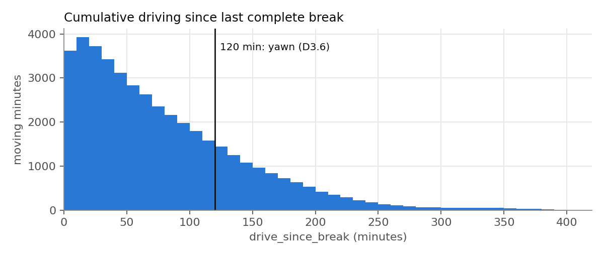

**อ่านกราฟนี้ว่า**
- ส่วนใหญ่ของเวลาวิ่งอยู่ในช่วงต้นของการขับ (ก่อน 2 ชม.) แท่งสูงทางซ้ายและต่ำลงทางขวา
- เส้น 120 นาที: มี **22.7%** ของนาทีที่วิ่งอยู่ทางขวาของเส้น ซึ่งมากพอที่ yawn จะเกิดจากเงื่อนไขนี้ได้

**ข้อจำกัด:** เรานับเอง จึงอาจไม่ตรงกับนาฬิกาขับที่ i-DREAMS ใช้คำนวณ Fatigue (ดูหน้า 4.2)

---

### หน้า 3.2 — `danger_2m`: จำนวนสัญญาณอันตรายใน 2 นาทีล่าสุด

**ความหมาย:** ใน 2 นาทีล่าสุด (รวมนาทีปัจจุบัน) เกิดสัญญาณอันตรายกี่ **ชนิด** จาก 3 ชนิด ได้ค่า 0–3 ชนิดละ 1 ไม่ถ่วงน้ำหนัก

**วิธีนับ:** สัญญาณ 3 ชนิด คือ (1) Headway ระดับ L2 หรือ L3 อย่างน้อย 1 วินาทีในนาทีนั้น (2) เบรกแรงระดับ M หรือ H อย่างน้อย 1 ครั้งในนาทีนั้น (3) Speeding ระดับ L2 หรือ L3 อย่างน้อย 1 วินาทีในนาทีนั้น (ตัวอย่าง: นาทีที่ 5 มี Headway และนาทีที่ 6 มี Speeding → ที่นาทีที่ 6 ค่าเป็น 2)

**เหตุผลและที่มาของตัวเลข**
- ข้อมูลไม่มีสัญญาณมือถือหรือสายตา จึงรวมพฤติกรรมอันตรายที่มีจริงในข้อมูลเป็นตัวเลขเดียว ให้ eye_off_road และ phone ใช้ร่วมกัน
- ระดับของ Headway และ Speeding มาจาก i-DREAMS D6.3 ตาราง 2 [3] ที่จัด L2 และ L3 เป็นระดับอันตราย
- ใช้เกณฑ์เบา (อย่างน้อย 1 วินาที) ได้ เพราะแต่ละสัญญาณเดี่ยว ๆ ยังไม่พอ ต้องมีอย่างน้อย 2 ชนิดพร้อมกันจึงเข้ากฎ (หน้า 4.5) ต่างจาก tailgating ที่ใช้สัญญาณเดียวจึงต้องเข้มกว่า (30 วินาที)
- เบรกแรงนับเฉพาะ M/H เพราะระดับ L เกิดถึง 29% ของนาที จึงเป็นการเบรกปกติ (สมมติฐานของทีม ไม่มีงานวิจัยกำหนด)
- หน้าต่าง 2 นาที มาจากกฎ priority alert ของรุ่นพี่ [5]

**กราฟที่ทดสอบ:** เทียบว่าแต่ละสัญญาณเกิดบ่อยแค่ไหน เมื่อดูเฉพาะนาทีนั้น (สีเทา) กับเมื่อดู 2 นาทีล่าสุด (สีส้ม ที่ใช้จริง)

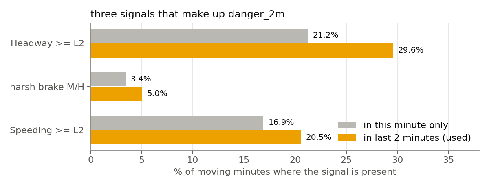

**อ่านกราฟนี้ว่า**
- การดู 2 นาทีล่าสุดทำให้ทุกสัญญาณเกิดบ่อยขึ้น: headway 21.2% → **29.6%**, เบรกแรง 3.4% → **5.0%**, speeding 16.9% → **20.5%** เพราะสัญญาณที่เกิดในนาทีก่อนหน้ายังนับอยู่
- headway และ speeding เกิดบ่อยกว่าเบรกแรงมาก จึงมีผลต่อ `danger_2m` มากที่สุด
- ผลรวม `danger_2m` = 0 / 1 / 2 / 3 อยู่ที่ 51.8 / 41.5 / 6.5 / 0.2% ของนาทีที่วิ่ง (นำไปใช้ในหน้า 4.5 และ 4.6)

**ข้อจำกัด:** การรวมสัญญาณแบบนี้เป็นสิ่งที่ทีมเลือกเอง ไม่มีงานวิจัยกำหนด

---

## ตอนที่ 4 — อธิบายทีละ field (1 หน้า = 1 event)

ทุกหน้าเรียงเหมือนกัน: **กฎ → เหตุผลและที่มาของตัวเลข → กราฟที่ทดสอบ → อ่านกราฟนี้ว่า → ข้อจำกัด**

---

### หน้า 4.1 — tailgating (ขับตามชิด) · `direct`

**บทพูด:** tailgating เป็น event เดียวที่มีข้อมูลตรง จึงเป็นเรื่องเดียวที่ตรวจความแม่นกับระยะจริงได้

> **กฎ:** Headway L3 ≥ 30 วินาทีในนาทีนั้น **และ** ความเร็ว ≥ 50 km/h

> **สรุป:** จะสร้าง tailgating ได้ **0.09 ครั้ง/ชม.**, **0.5 ครั้ง/คัน-วัน**, **23%** ของคัน-วันที่เกิด ≥ 1 ครั้ง (เป็น event ที่หายากที่สุด แต่ตรวจแล้วถูก 96.4%)

**เหตุผลและที่มาของตัวเลข**
- SCGJWD นิยาม tailgating ว่าความเร็ว ≥ 50 km/h และห่างรถคันหน้า ≤ 20 ม. [5] เราใช้ 50 km/h ตามนิยามนี้
- i-DREAMS ไม่ให้ระยะ แต่ให้จำนวนวินาทีในนาทีนั้นที่อยู่แต่ละระดับ Headway โดย L3 คือระดับชิดที่สุด [3]
- เราเคยนิยามว่า "นาทีใดมี L3 แม้วินาทีเดียวถือว่า tailgating" แต่วัดแล้วพบว่าไม่แม่น (ดูกราฟ) จึงเปลี่ยนเป็น "L3 ต้องอยู่ **อย่างน้อย 30 วินาที** ของนาทีนั้น"
- เลข 30 วินาทีเป็นค่าที่ทีมเลือก (ครึ่งหนึ่งของนาที) แต่มีผลวัดรองรับ

**กราฟที่ทดสอบ:** ตรวจว่านาทีที่เรา flag เป็น tailgating เป็น tailgating จริงตามนิยามของ SCGJWD หรือไม่ โดยคำนวณระยะจริง = headway (วินาที) × ความเร็ว ÷ 3.6 แล้วนับว่ามีกี่ % ที่ระยะ ≤ 20 ม. (เรียกว่า "ถูก")

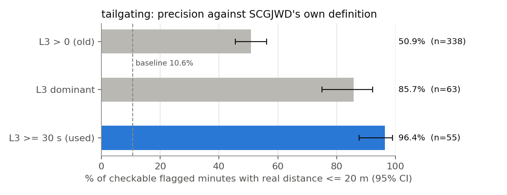

**อ่านกราฟนี้ว่า** (แท่งยิ่งยาว = flag แล้วถูกมากขึ้น)
- **แท่งบน (นิยามเดิม: L3 > 0):** flag แล้วถูกแค่ 50.9% หรือครึ่งหนึ่ง อีกครึ่งเป็นการแตะ L3 สั้น ๆ ที่ระยะจริงไม่ได้ชิดตามนิยาม → จึงเลิกใช้นิยามนี้
- **แท่งกลาง (L3 เป็นระดับที่เด่นที่สุดของนาที):** ถูก 85.7% ดีขึ้น แต่ยังพลาดอยู่
- **แท่งล่าง (L3 ≥ 30 วินาที ที่เลือกใช้):** ถูก **96.4%** เกือบทั้งหมด
- เส้นประคือ baseline 10.6% หมายถึงถ้าสุ่มเลือกนาทีที่เร็ว ≥ 50 km/h จะถูกเพียงเท่านี้ ทั้งสามนิยามจึงดีกว่าการเดา
- สิ่งที่ต้องแลก: event ลดจาก 1.53 เหลือ **0.09 ครั้ง/ชม.**

**ข้อจำกัด:** ตรวจได้เฉพาะนาทีที่ headway วัดได้ (55 จาก 82 นาทีที่ flag) และเกณฑ์ 30 วินาทีเป็นค่าที่ทีมเลือก

---

### หน้า 4.2 — yawn (หาว) · `derived-weak`

**บทพูด:** ข้อมูลไม่มีกล้อง จึงไม่ได้ตรวจจับการหาว เรากำหนดว่าสถานการณ์ที่ล้ามากคือสถานการณ์ที่ G7 ควรเตือนเรื่องหาว

> **กฎ:** Fatigue ≥ L1 **หรือ** `drive_since_break` ≥ 120 นาที

> **สรุป:** จะสร้าง yawn ได้ **1.61 ครั้ง/ชม.**, **8.6 ครั้ง/คัน-วัน**, **74%** ของคัน-วันที่เกิด ≥ 1 ครั้ง (เป็น event ที่เกิดบ่อยที่สุดของระบบ)

**เหตุผลและที่มาของตัวเลข**
- Fatigue ของ i-DREAMS วัดจากระยะเวลาขับ ไม่ได้วัดจากอาการ [2] จึงใช้เป็นตัวแทนความล้า
- ใช้สองเงื่อนไขแบบ "หรือ" เพราะวัดความล้าคนละแบบ: (1) ระดับเตือนที่ i-DREAMS คำนวณมาให้ (2) เวลาขับสะสมที่เรานับเองโดยคำนึงถึงการพัก (หน้า 3.1)
- 120 นาที มาจาก D3.6 ตาราง 6: ขับ < 2 ชม. ถือว่าปกติ [2]
- เกณฑ์ Fatigue ของ i-DREAMS ปรับตามอายุและเพศ ซึ่งข้อมูลเราไม่มี จึงใช้ 2 ชม. เป็นเกณฑ์เดียวกันทุกคน [2]

**กราฟที่ทดสอบ:** ถ้าสองเงื่อนไขวัดสิ่งเดียวกัน นาทีส่วนใหญ่ควรเข้าทั้งสองพร้อมกัน กราฟซ้ายนับนาทีตามเงื่อนไขที่เข้า กราฟขวานับ event ตามเงื่อนไขที่ทำให้เกิด

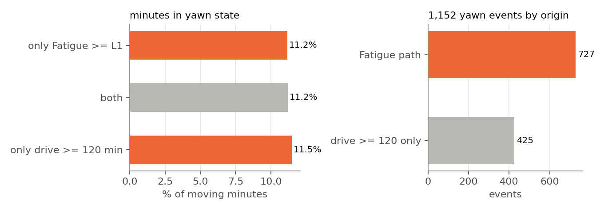

**อ่านกราฟนี้ว่า**
- **กราฟซ้าย:** นาทีที่เข้าเงื่อนไขแบ่งเป็น 3 ส่วนเท่า ๆ กัน (เข้าเฉพาะ Fatigue 11.2% / เข้าทั้งคู่ 11.2% / เข้าเฉพาะ ≥ 120 นาที 11.5%) แปลว่าสองเงื่อนไข **ซ้อนกันเพียงครึ่งเดียว** ไม่ได้วัดสิ่งเดียวกัน
- **กราฟขวา:** จาก 1,152 event มี **425 (37%)** ที่เกิดจากเงื่อนไข ≥ 120 นาทีอย่างเดียว ถ้าตัดเงื่อนไขนี้ทิ้งจะเสีย event ไปกว่าหนึ่งในสาม จึงเก็บทั้งสองเงื่อนไขไว้
- นาทีเข้าเงื่อนไขรวม **33.9%** ของนาทีที่วิ่ง อัตรา event **1.61 ครั้ง/ชม.**

**ข้อจำกัด:** ยังไม่ทราบสาเหตุที่สองเงื่อนไขไม่ตรงกัน (นาฬิกาขับของ i-DREAMS อาจนับต่างจากเรา หรือเกณฑ์ปรับตามอายุและเพศ) และไม่ได้วัดการหาวจริง

---

### หน้า 4.3 — eye_close (หลับตา) · `derived-weak`

**บทพูด:** การหลับตาหนักกว่าการหาว จึงต้องล้ากว่าและเป็นส่วนหนึ่งของ yawn

> **กฎ:** Fatigue ≥ L2 **และ** กลางคืน

> **สรุป:** จะสร้าง eye_close ได้ **0.55 ครั้ง/ชม.**, **3.0 ครั้ง/คัน-วัน**, **27%** ของคัน-วันที่เกิด ≥ 1 ครั้ง (หายากกว่า yawn ประมาณ 3 เท่า ตามที่ออกแบบให้เป็นส่วนหนึ่งของ yawn)

**เหตุผลและที่มาของตัวเลข**
- ต้องล้าระดับสูงกว่า yawn (L2 แทน L1) เพราะการหลับตาหนักกว่าการหาว ระดับ Fatigue มาจาก D3.6 [2]
- ต้องเป็นช่วงกลางคืนด้วย เพราะเป็นช่วงที่ง่วงง่าย กลางคืนอ่านจาก `time_indicator` = 3 [4] (หลักฐานเรื่องนี้ยังขัดแย้งกัน ดูข้อจำกัด)
- เนื่องจาก L2 เป็นส่วนหนึ่งของ L1 นาทีที่เข้ากฎนี้จึงเข้ากฎ yawn ด้วยเสมอ ทำให้ eye_close เป็นส่วนหนึ่งของ yawn ตามที่ต้องการ
- ใช้เกณฑ์ Fatigue เดียวกันทุกคนด้วยเหตุผลเดียวกับหน้า 4.2
- เดิมกฎมีอีกเงื่อนไข "Fatigue ≥ L1 และขับสะสม ≥ 270 นาที" (เพดานขับ 4.5 ชม. ตามกฎหมาย EU) แต่ตัดออกแล้ว เพราะให้ event เพียง 6 จาก 402 (บันทึกใน D-30)

**กราฟที่ทดสอบ:** ดูว่าแต่ละส่วนประกอบของกฎ (กลางคืน, Fatigue ≥ L2) เกิดบ่อยแค่ไหน และเมื่อเกิดพร้อมกันได้นาทีที่เข้ากฎเท่าไร

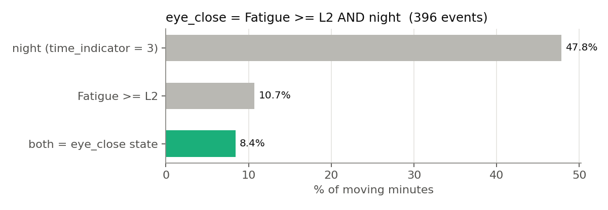

**อ่านกราฟนี้ว่า**
- กลางคืนเกิด 47.8% ของนาทีที่วิ่ง และ Fatigue ≥ L2 เกิด 10.7%
- เมื่อเกิดพร้อมกันได้ **8.4%** ของนาทีที่วิ่ง ซึ่งเป็นนาทีที่เข้ากฎ eye_close
- จากนาทีเหล่านี้ได้ **396 event** อัตรา **0.55 ครั้ง/ชม.**
- Fatigue ≥ L2 ไม่ได้เกิดเฉพาะกลางคืน (10.7% เทียบกับ 8.4%) ส่วนที่เกิดตอนกลางวันไม่นับเป็น eye_close

**ข้อจำกัด:** หลักฐานว่ากลางคืนง่วงกว่ากลางวันยังขัดแย้งกัน (ตอนที่ 6.4) และไม่ได้วัดการหลับตาจริง

---

### หน้า 4.4 — วิธีนับ yawn / eye_close: "2 นาทีแรกของช่วง"

**บทพูด:** สถานะ Fatigue ค้างต่อเนื่องหลายนาที จึงต้องกำหนดว่าจะนับเป็น event อย่างไร เราลอง 3 วิธีแล้วเทียบ

**3 วิธีที่เทียบ**
- **นับต่อช่วง:** ช่วงที่เข้าเงื่อนไขต่อเนื่องกันนับเป็น 1 event
- **2 นาทีแรกของช่วง (ที่ใช้):** นับ event ที่นาทีแรกและนาทีที่สองของช่วง
- **นับทุกนาที:** ทุกนาทีที่เข้าเงื่อนไขนับเป็น 1 event

|                                      | นับต่อช่วง        | **2 นาทีแรกของช่วง (ใช้)** | นับทุกนาที        |
| ------------------------------------ | ----------------- | -------------------------- | ----------------- |
| yawn / eye_close (ครั้ง/ชม.)         | 0.93 / 0.34       | 1.61 / 0.55                | 20.3 / 5.1        |
| สถานะต่อคัน-วัน LOW / MED / HIGH (%) | 46.3 / 45.5 / 8.2 | **33.6 / 44.8 / 21.6**     | 21.6 / 6.7 / 71.6 |
| alert ความล้า (ครั้ง/ชม./รถ)         | **0.00**          | 0.78                       | 0.59              |

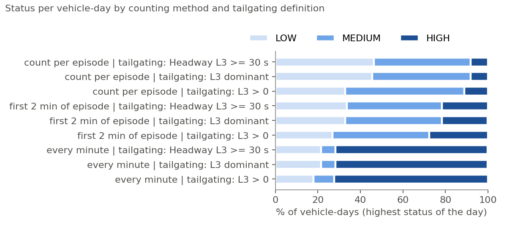

**กราฟนี้ทดสอบ:** วิธีนับ yawn/eye_close 3 แบบ × นิยาม tailgating 3 แบบ (รวม 9 แถว) แต่ละแถวคือสัดส่วนคัน-วันที่มีสถานะสูงสุดของวันเป็น LOW / MEDIUM / HIGH แถวที่ใช้จริงคือ "first 2 min of episode | tailgating: Headway L3 >= 30 s"

**อ่านผลนี้ว่า**
- **นับต่อช่วง:** event น้อยเกินไป alert "yawn หรือ eye_close ≥ 2 ครั้งใน 2 นาที" ของรุ่นพี่ [5] **ไม่เคยยิงเลย** (0.00) ระบบส่วนนี้ใช้งานไม่ได้
- **นับทุกนาที:** event มากเกินไป 72% ของคัน-วันเป็น HIGH จึงแยกรถเสี่ยงออกจากรถปกติไม่ได้
- **2 นาทีแรก:** อยู่ระหว่างสองแบบ และทำให้ alert ยิงได้ จึงเลือกแบบนี้

**ข้อจำกัด:** กฎ "2 นาทีแรก" **ไม่มีงานวิจัยรองรับ** เป็นการเลือกของทีม สิ่งที่มีงานวิจัยรองรับคือรูปแบบของ alert ว่าการหาวซ้ำในช่วงสั้นบ่งชี้ความล้า (Kassem et al. 2020: หาว 1 ครั้ง/นาทีคือความล้าระยะแรก [7]; สิทธิบัตร US 6927694: ประมาณ 3 ครั้งใน 30 วินาที [8]) และ PERCLOS วัดตาปิดในหน้าต่าง 1 นาที [9] แต่ข้อมูลเราไม่ได้วัดการหาวหรือตาปิดจริง

---

### หน้า 4.5 — eye_off_road (มองนอกถนน) · `proxy-weak`

**บทพูด:** ข้อมูลไม่มีทิศทางสายตา จึงใช้การเกิดพฤติกรรมอันตรายหลายอย่างพร้อมกันเป็นตัวแทน ซึ่งเป็น field ที่เหตุผลอ่อนที่สุด

> **กฎ:** `danger_2m` ≥ 2 (ใน 2 นาทีล่าสุดเกิดสัญญาณอันตรายอย่างน้อย 2 ชนิดจาก 3 ตามหน้า 3.2)

> **สรุป:** จะสร้าง eye_off_road ได้ **1.57 ครั้ง/ชม.**, **8.4 ครั้ง/คัน-วัน**, **78%** ของคัน-วันที่เกิด ≥ 1 ครั้ง (เกิดบ่อยพอ ๆ กับ yawn)

**เหตุผลและที่มาของตัวเลข**
- สมมติฐาน: เมื่อคนขับละสายตา จะเห็นผลเป็นการตามรถคันหน้าชิด การเบรกกะทันหัน และการขับเร็ว สอดคล้องกับงานที่พบว่าการเสียสมาธิทำให้เวลาตอบสนองเสียหายมากที่สุด [6]
- ใช้ "≥ 2 จาก 3" เพราะเกิดเพียง 1 ชนิดนั้นพบบ่อย (41.5% ของนาที) และเป็นการขับปกติ ต้องมีสองชนิดขึ้นไปจึงนับ เลขนี้เป็นการเลือกของทีม (เสียงข้างมาก) ไม่มีงานวิจัยกำหนด
- เกณฑ์ของแต่ละสัญญาณและหน้าต่าง 2 นาที ดูที่มาในหน้า 3.2 [3][5]

**กราฟที่ทดสอบ:** กราฟซ้ายดูว่า `danger_2m` แต่ละค่าเกิดบ่อยแค่ไหน (สีส้ม = ค่าที่เข้ากฎ) กราฟขวาแยกนาทีที่เข้ากฎตามคู่สัญญาณที่ทำให้เข้า

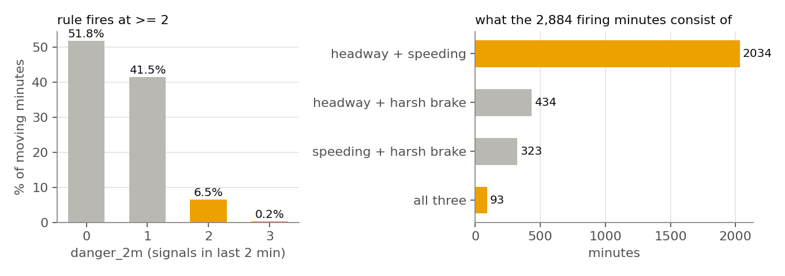

**อ่านกราฟนี้ว่า**
- **กราฟซ้าย:** กฎเข้าเงื่อนไขเพียง 6.7% ของนาทีที่วิ่ง (ค่า 2 คือ 6.5% และค่า 3 คือ 0.2%) ที่เหลือส่วนใหญ่ไม่มีสัญญาณหรือมีชนิดเดียว
- **กราฟขวา:** จาก 2,884 นาทีที่เข้ากฎ **71% (2,034 นาที) เป็นคู่ Headway + Speeding** ส่วนที่มีเบรกแรงเกี่ยวข้อง 850 นาที (29%)
- นั่นหมายความว่า eye_off_road ส่วนใหญ่คือ "ตามชิดและขับเร็วพร้อมกัน" มากกว่าการเบรกกะทันหัน
- อัตรา event **1.57 ครั้ง/ชม.**

**ข้อจำกัด (จุดที่อาจารย์น่าจะถาม):** ตามชิดและขับเร็วพร้อมกันเป็นพฤติกรรมเสี่ยงโดยรวม ไม่ใช่หลักฐานว่าตามองนอกถนน จึงติดป้าย `proxy-weak` และอธิบายว่าเป็น "สถานการณ์เสี่ยงที่ G7 น่าจะเตือน"

---

### หน้า 4.6 — phone (ใช้มือถือ) · `proxy-weak`

**บทพูด:** ข้อมูลโทรศัพท์ของรถบรรทุกใช้ได้เพียง 2 คนขับ (D7.2 [11]) จึงกำหนดให้ phone เป็นกรณีที่รุนแรงกว่าและหายากกว่า eye_off_road

> **กฎ:** `danger_2m` = 3 **หรือ** (`danger_2m` ≥ 2 **และ** มีเขตคนเดินถนนใน 2 นาที)

> **สรุป:** จะสร้าง phone ได้ **0.14 ครั้ง/ชม.**, **0.8 ครั้ง/คัน-วัน**, **31%** ของคัน-วันที่เกิด ≥ 1 ครั้ง (หายากกว่า eye_off_road ประมาณ 11 เท่า และ ข้อมูลโทรศัพท์ของรถบรรทุกใช้ได้เพียง 2 คนขับ [11])

**เหตุผลและที่มาของตัวเลข**
- โทรศัพท์เป็นการเสียสมาธิแบบหนึ่ง จึงเป็นส่วนหนึ่งของ eye_off_road และต้องเข้มกว่า
- งานวิจัยพบว่าโทรศัพท์ทำให้เวลาตอบสนองช้าลงมากที่สุด และแบบถือกับแฮนด์ฟรีให้ผลใกล้เคียงกัน [6]
- เงื่อนไขที่ 1: ครบทั้ง 3 สัญญาณใน 2 นาที (เข้มกว่า eye_off_road หนึ่งระดับ ทีมเลือก)
- เงื่อนไขที่ 2: 2 สัญญาณขึ้นไป **และ** อยู่ในเขตคนเดินถนน ซึ่งเป็นช่วงที่เวลาตอบสนองสำคัญที่สุด (ทีมเลือก)
- "มีเขตคนเดินถนน" อ่านจากคอลัมน์ `ME_AWS_pedestrian_dz_mean` โดย `> 0` หมายถึงในนาทีนั้นตรวจพบคนเดินถนนในเขตอันตรายอย่างน้อย 1 ครั้ง (คอลัมน์นี้คือจำนวนครั้งที่ตรวจพบในช่วงเวลานั้น ÷ 60 [12]) "ใน 2 นาที" คือนาทีปัจจุบันและนาทีก่อนหน้า
- เกณฑ์ของสัญญาณและหน้าต่าง 2 นาที ดูที่มาในหน้า 3.2 และ 4.5

**กราฟที่ทดสอบ:** กราฟซ้ายเทียบความถี่ของ phone กับ eye_off_road กราฟขวาแยกนาทีที่เข้ากฎตามเงื่อนไขที่ทำให้เข้า

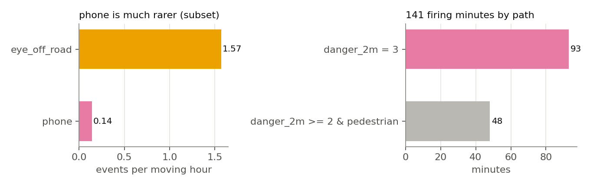

**อ่านกราฟนี้ว่า**
- **กราฟซ้าย:** phone เกิด **0.14 ครั้ง/ชม.** เทียบกับ eye_off_road 1.57 (ราว 1 ใน 11) หายากกว่าตามที่ออกแบบ และตรวจแล้วว่า phone เป็นส่วนหนึ่งของ eye_off_road จริง ไม่มีนาทีใดอยู่นอกขอบเขต
- **กราฟขวา:** 141 นาทีที่เข้ากฎ มี **93 นาที** มาจากเงื่อนไขที่ 1 (ครบ 3 สัญญาณ) และ **48 นาที** จากเงื่อนไขที่ 2 (เขตคนเดินถนนใน 2 นาทีล่าสุด ซึ่งปรากฏใน 1.5% ของนาทีที่วิ่ง)

**ข้อจำกัด:** เช่นเดียวกับหน้า 4.5 และไม่มีงานวิจัยยืนยันว่า "3 จาก 3" หรือ "เขตคนเดินถนน" ตรงกับการใช้โทรศัพท์จริง

---

## ตอนที่ 5 — ค่าที่ใช้ร่วมกัน และการตรวจสอบโค้ด

### หน้า 5.1 — ค่าคงที่ทั้งหมดและที่มา (no magic number)

**บทพูด:** หน้านี้รวมทุกค่าที่ใช้ในกฎ ค่าใดมีที่มาแสดงเลขอ้างอิง ค่าใดไม่มีระบุว่าเป็นการเลือกของทีม

| ค่า | ใช้ที่ | ที่มา | สถานะ |
|---|---|---|---|
| 120 นาที | yawn | D3.6 ตาราง 6: ขับ < 2 ชม. ถือว่าปกติ [2] | มีที่มา |
| พัก 45 / 15 + 30 นาที | `drive_since_break` | EU 561/2006 ข้อ 7 [1] | มีที่มา |
| 50 km/h, 20 ม. | tailgating | นิยามของ SCGJWD [5] | มีที่มา |
| Headway / Speeding L2–L3 | tailgating, `danger_2m` | D6.3 ตาราง 2 [3] | มีที่มา |
| กลางคืน (`time_indicator` = 3) | eye_close | D6.1 ตาราง 2 [4] | มีที่มา |
| หน้าต่าง 2 นาที | `danger_2m`, alert | กฎ priority alert ของรุ่นพี่ [5] | มีที่มา |
| ≥ 6 / ≥ 3 event ใน 10 นาที | สถานะ HIGH / MEDIUM | กฎ real-time ของรุ่นพี่ [5] | มีที่มา |
| 30 วินาที | tailgating | ครึ่งหนึ่งของนาที และวัดความแม่นเทียบระยะจริง (หน้า 4.1) | ทีมเลือก |
| 2 นาทีแรกของช่วง | yawn, eye_close | เลือกเพื่อให้ alert ยิงได้ ไม่มีงานวิจัย (หน้า 4.4) | ทีมเลือก |
| เบรกแรงระดับ M/H | `danger_2m` | ระดับ L เกิด 29% ของนาที จึงไม่นับว่าแรง; M/H เกิด 3.1% / 0.4% และความเร็วลดจริงราว 7 km/h | สมมติฐานของทีม |
| ≥ 2 จาก 3 สัญญาณ, = 3 จาก 3 | eye_off_road, phone | เสียงข้างมากของสัญญาณใน `danger_2m` | ทีมเลือก |
| เขตคนเดินถนนใน 2 นาที | phone | ช่วงที่เวลาตอบสนองสำคัญ | ทีมเลือก |
| รถวิ่ง > 5 km/h | ทุกกฎ | ไม่พบที่มาในเอกสารรุ่นพี่ ข้อมูลแยกกลุ่มรถจอด (≤ 0.5 km/h) ชัดเจน แต่ไม่มีช่องว่างธรรมชาติที่ 5 km/h | ทีมเลือก |

**กราฟที่ทดสอบ:** การกระจายความเร็วของทุกนาทีในข้อมูล เส้นเกณฑ์ 5 km/h

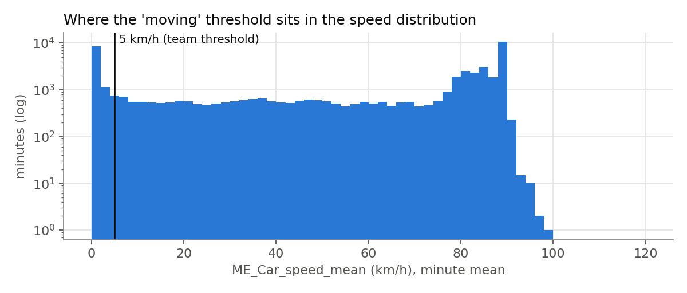

**กราฟนี้บอกว่า:** รถที่จอด (≤ 0.5 km/h) แยกเป็นกลุ่มชัดเจน แต่ไม่มีช่องว่างตามธรรมชาติที่ 5 km/h จึงต้องบอกว่าเป็นค่าที่ทีมเลือก ไม่ใช่ค่าที่ข้อมูลกำหนด

### หน้า 5.2 — โค้ดสองแบบต้องให้ผลเหมือนกัน

**บทพูด:** ระบบจริงรับข้อมูลทีละนาที จึงเขียน mapper อีกเวอร์ชันที่รับทีละแถว แล้วเทียบกับเวอร์ชัน batch

- เทียบทุกแถว (52,770 แถว) ใน 4 การตั้งค่า ได้แก่ event 5 ชนิด, สถานะ 10 นาที, alert 4 ชนิด และ `drive_since_break` → **ไม่มีแถวใดต่างกัน**
- ทดสอบว่าเทสต์จับความผิดได้จริง: เปลี่ยนเกณฑ์ yawn ฝั่ง streaming เป็น 121 นาที เทสต์จับความต่างได้ 160 แถว

---

## ตอนที่ 6 — ผลที่ได้ และสิ่งที่เรายังไม่รู้

### 6.1 หนึ่งวันของรถหนึ่งคัน

**บทพูด:** ภาพนี้ไม่ใช่ค่าเฉลี่ย แต่เป็นตัวอย่างรถ 1 คัน คนขับ 1 คน ใน 1 วัน (วันที่ 20/04/2022 คนขับ 8) (วันที่มี HIGH และจำนวน event อยู่ตรงกลางในกลุ่มวันที่ขับ > 4 ชม.) จุดสีคือ event แถบล่างคือสถานะ 10 นาที

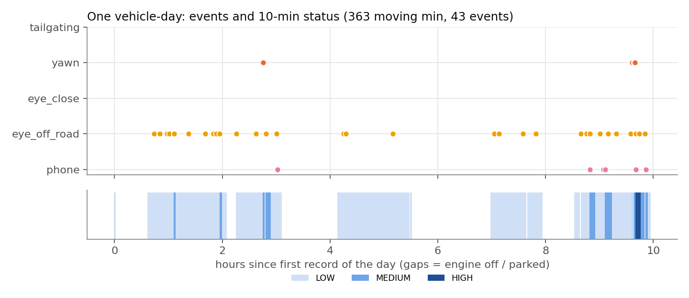

สังเกต: วันนี้ (วิ่ง 363 นาที เกิด 43 event) มี eye_off_road กระจายตลอดวัน, phone เกิดตามกลุ่ม eye_off_road (เป็นส่วนหนึ่งของกัน) และสถานะ HIGH เกิดช่วงชั่วโมงที่ 9.7 ซึ่งเป็นช่วงที่ event หลายชนิดขึ้นถี่ในเวลาสั้น ๆ

### 6.2 ภาพรวมทั้งข้อมูล

**บทพูด:** ส่วนนี้สรุปผลของ mapper ทั้งชุดข้อมูล (714.5 ชม.ที่รถวิ่ง, 134 คัน-วัน) ใน 3 ระดับ คือจำนวน event, สถานะ LOW/MEDIUM/HIGH และ priority alert ซึ่งเป็นสิ่งที่ระบบรุ่นพี่นำไปใช้ต่อ

**(1) จำนวน event ต่อชั่วโมง**

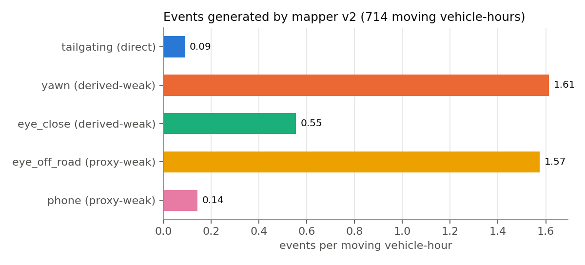

- **ขอบเขต: ค่าเฉลี่ยรวมทุกคนขับ ทุกคัน ทุกวัน** (event ทั้งหมดของชนิดนั้น ÷ 714.5 ชม.ที่รถวิ่งทั้งชุดข้อมูล) ไม่ใช่ของคนใดคนหนึ่ง (ความต่างระหว่างคนขับดูที่ 6.3)
- แต่ละแท่งคือจำนวน event ของชนิดนั้นต่อชั่วโมงที่รถวิ่ง รวมทั้งหมด **3.97 ครั้ง/ชม.**
- yawn (1.61) และ eye_off_road (1.57) เกิดบ่อยที่สุด รวมกันราว 80% ของ event ทั้งหมด
- tailgating (0.09) และ phone (0.14) หายาก ตามที่ออกแบบให้เป็นเหตุการณ์รุนแรง

**(2) สัดส่วนสถานะ LOW / MEDIUM / HIGH (สถานะวัดจาก event ใน 10 นาทีล่าสุด)**

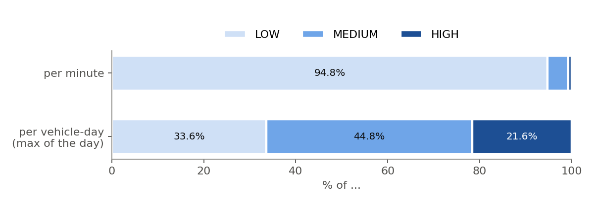

- **ขอบเขต: รวมทุกคนขับ ทุกคัน** แท่งบนนับจากทุกนาทีที่รถวิ่ง (42,869 นาที) แท่งล่างนับจากทุกคัน-วัน (134 คัน-วัน)
- สถานะคำนวณตามกฎของรุ่นพี่ [5]: นับ event ใน 10 นาทีล่าสุด ≥ 6 ครั้ง = HIGH, ≥ 3 ครั้ง = MEDIUM, น้อยกว่านั้น = LOW
- **แท่งบน (ต่อนาที):** 94.8% ของนาทีเป็น LOW, MEDIUM 4.5%, HIGH 0.7% แปลว่า HIGH เป็นสถานการณ์ที่เกิดเฉพาะช่วงสั้น ๆ
- **แท่งล่าง (ต่อคัน-วัน):** ดูสถานะสูงสุดที่คัน-วันนั้นเคยไปถึง ได้ LOW 33.6% / MEDIUM 44.8% / HIGH 21.6% ซึ่งแยกเป็น 3 กลุ่มพอสมควร ไม่กระจุกกลุ่มเดียว
- สัดส่วนนี้ **ไม่ได้ปรับให้ตรงเป้าใด ๆ** เป็นผลที่ออกมาจากกฎ (ดูตอนที่ 6.4 ข้อ 2)

**(3) จำนวน priority alert ต่อชั่วโมง (alert = การเตือนทันทีตามกฎของรุ่นพี่)**

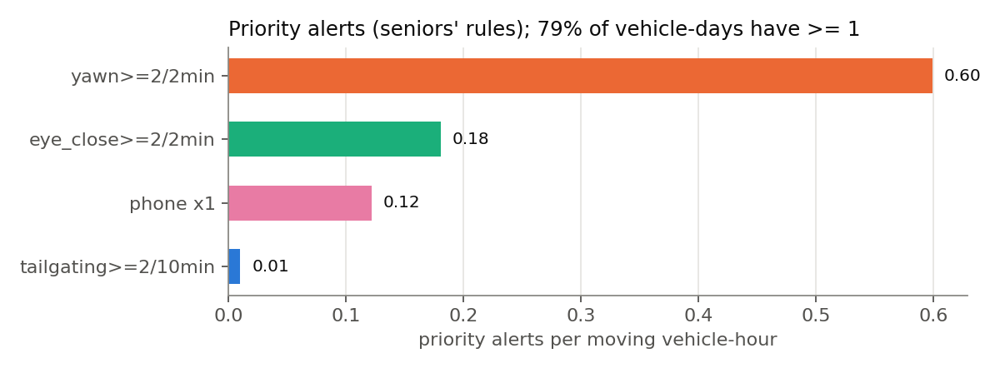

- **ขอบเขต: ค่าเฉลี่ยรวมทุกคนขับ ทุกคัน** (จำนวน alert ทั้งหมด ÷ ชั่วโมงที่รถวิ่งรวม)
- alert คือการเตือนที่ระบบรุ่นพี่ยิงทันที [5] มี 4 แบบ: yawn ≥ 2 ครั้งใน 2 นาที, eye_close ≥ 2 ครั้งใน 2 นาที, phone แค่ 1 ครั้ง, tailgating ≥ 2 ครั้งใน 10 นาทีที่ความเร็ว ≥ 50 km/h
- แต่ละแท่งคือจำนวน alert ต่อชั่วโมงที่รถ 1 คันวิ่ง รวม **0.91 ครั้ง/ชม./รถ** (ถ้ามีรถวิ่งพร้อมกัน 10 คัน ≈ 9 ครั้ง/ชม.)
- alert ของ yawn (0.60) มากที่สุด เพราะ yawn เกิดบ่อย ส่วน tailgating (0.01) แทบไม่เกิด
- **79% ของคัน-วันมี alert อย่างน้อย 1 ครั้ง** ซึ่งค่อนข้างบ่อย (ดูตอนที่ 6.4 ข้อ 3)

**ตัวเลขสรุป**

| ตัวชี้วัด | ค่า |
|---|---|
| event รวม | 3.97 ครั้ง/ชม.ที่รถวิ่ง (tailgating 0.09 · yawn 1.61 · eye_close 0.55 · eye_off_road 1.57 · phone 0.14) |
| สถานะ 10 นาที ต่อนาที | LOW 94.7% · MEDIUM 4.5% · HIGH 0.7% |
| สถานะต่อคัน-วัน (ค่าสูงสุดของวัน) | LOW 33.6% · MEDIUM 44.8% · HIGH 21.6% |
| priority alert | 0.91 ครั้ง/ชม./รถ (≈ 9 ครั้ง/ชม. เมื่อมีรถวิ่งพร้อมกัน 10 คัน) · 79% ของคัน-วันมี alert อย่างน้อย 1 ครั้ง |

### 6.3 ความต่างระหว่างคนขับ

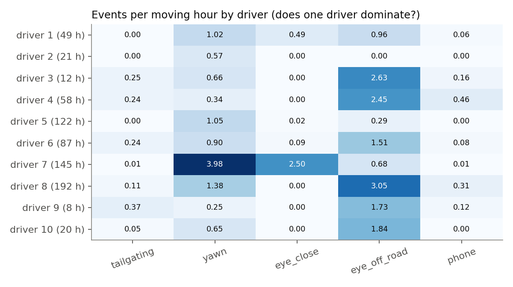

- **ขอบเขต: แยกรายคนขับ** (10 คน) แต่ละช่องคือ event ต่อชั่วโมงที่คนขับคนนั้นวิ่ง ตัวเลขในวงเล็บคือชั่วโมงที่คนนั้นวิ่งรวม เทียบกับค่าเฉลี่ยรวมในหัวข้อ 6.2 ได้
- คนขับ 7 (145 ชม.) ให้ yawn 3.98 และ eye_close 2.50 ครั้ง/ชม. สูงกว่าคนอื่นมาก ขณะที่ eye_close ของคนขับ 2, 3, 4, 8, 9, 10 เป็นศูนย์
- คนขับ 8, 3, 4 สูงเรื่อง eye_off_road (2.4–3.1 ครั้ง/ชม.) · tailgating เป็นศูนย์ในคนขับ 1, 2, 5
- **ความต่างมาจากข้อมูลจริง ไม่ใช่การสุ่ม** แต่ยังไม่ได้แยกว่าเกิดจากพฤติกรรมหรือแค่เวลาขับยาว

### 6.4 สิ่งที่เรายังไม่รู้ (ตรงไปตรงมา)

1. **ไม่มี ground truth ของ event 4 ใน 5 ชนิด** — yawn/eye_close/eye_off_road/phone เป็น proxy ทั้งหมด วัดความถูกต้องไม่ได้ วัดได้แค่ความสมเหตุสมผลและความสอดคล้องกับงานวิจัย
2. **ไม่มีฟังก์ชัน label รายวัน** — จึงยังเทียบสัดส่วนที่ได้กับเป้าที่เคยตั้งไว้ไม่ได้ และเรา **ไม่ได้ปรับกฎให้ได้สัดส่วนตามเป้า**
3. **alert บ่อย** — 79% ของคัน-วันมี alert ≥ 1 ครั้ง ส่วนใหญ่เป็นเรื่องความล้า ซึ่ง admin จริงอาจเห็นว่ามากไป
4. **หลักฐานเรื่องกลางคืนและเวลาขับกับความล้าขัดแย้งกัน** — บางงานพบความเสี่ยงสูงช่วงกลางคืน/ขาดการพัก (งาน Monash ที่สื่อรายงาน, ETSC) บางงานไม่พบ (Drissel & Spiegel, FMCSA/Hanowski, EC Road Safety Observatory) — **ยังไม่ได้เปิดต้นฉบับ ห้ามอ้างตัวเลข**
5. **เกณฑ์ที่ทีมเลือก:** 30 วินาที (tailgating), เบรกแรง M/H, รถวิ่ง > 5 km/h, "2 นาทีแรก" ของ fatigue
6. **ยังไม่เคยทดสอบกับ Kafka และระบบรุ่นพี่จริง** (D-19)

---

## สิ่งที่ขอคำแนะนำจากอาจารย์

1. **แนวทาง proxy + ป้ายที่มา** (`direct` / `derived-weak` / `proxy-weak`) เพียงพอไหม หรืออาจารย์อยากให้ตัด event ที่เป็น proxy อ่อนออก
2. **กฎ "2 นาทีแรก" ของ fatigue** ยอมรับได้ไหม หรือให้เลือก "ต่อช่วง" แล้วบอกข้อจำกัดว่า alert ความล้าไม่ยิง
3. **เกณฑ์ที่ทีมเลือก 4 ตัว** อาจารย์มีแหล่งอ้างอิงหรือแนวทางไหมที่ดีกว่า
4. **สัดส่วน LOW/MED/HIGH ที่ "เหมาะสม" ควรนิยามอย่างไร** — ต้องมี label รายวันก่อน อาจารย์เห็นด้วยกับ "สถานะ 10 นาทีสูงสุดของวัน" ไหม
5. **ขั้นต่อไป:** ระบบ mock real-time — เล่นข้อมูลจริงทีละนาที 1 คัน = 1 trip จริง เริ่มห่างกันเท่า ๆ กัน ไม่ผสมคอลัมน์ข้ามคนขับ และไม่สุ่ม

---

## ภาคผนวก — เอกสารอ้างอิง

| #    | แหล่งอ้างอิง                                                                                                                                                   | ใช้กับ                                                | สถานะการตรวจ                         |
| ---- | -------------------------------------------------------------------------------------------------------------------------------------------------------------- | ----------------------------------------------------- | ------------------------------------ |
| [1]  | Regulation (EC) No 561/2006, Art. 7 — https://www.legislation.gov.uk/eur/2006/561/article/7/data.htm                                                           | การพัก 45 / 15 + 30 นาที (ใช้นับ `drive_since_break`) | ตรวจจากข้อความกฎหมายแล้ว             |
| [2]  | i-DREAMS D3.6 §2.4.4 และตาราง 6 (ไฟล์ PDF ในโฟลเดอร์ทีม)                                                                                                       | Fatigue = เวลาขับ, เกณฑ์ 120 นาที                     | ตรวจจากไฟล์ PDF แล้ว                 |
| [3]  | i-DREAMS D6.3 ตาราง 2 (ไฟล์ในโฟลเดอร์ทีม)                                                                                                                      | ระดับ Headway / Speeding                              | เลขตารางยังไม่ได้เปิดตรวจซ้ำ         |
| [4]  | i-DREAMS D6.1 ตาราง 2 (ไฟล์ในโฟลเดอร์ทีม)                                                                                                                      | `time_indicator` (กลางคืน)                            | เลขตารางยังไม่ได้เปิดตรวจซ้ำ         |
| [5]  | นิยาม tailgating ของ SCGJWD, กฎสถานะ 10 นาทีและ priority alert ของรุ่นพี่ (โน้ตทีม [[09-g7-definitions-from-seniors]], [[13-integration-with-seniors-system]]) | tailgating, สถานะ, alert, หน้าต่าง 2 นาที             | อ้างจากโน้ตทีม                       |
| [6]  | Caird et al. (2008), *Accid Anal Prev* 40(4):1282–93 — https://doi.org/10.1016/j.aap.2008.01.009                                                               | ผลของโทรศัพท์และการเสียสมาธิต่อเวลาตอบสนอง            | ตรวจ abstract แล้ว                   |
| [7]  | Kassem et al. (2020), CATA 2020, EPiC vol. 69 pp. 372–382                                                                                                      | ระดับความล้าจากจำนวนครั้งที่หาวต่อนาที                | ตรวจจากบทคัดย่อ                      |
| [8]  | US Patent 6927694 — https://patents.google.com/patent/US6927694                                                                                                | เตือนเมื่อหาวประมาณ 3 ครั้งใน 30 วินาที               | ตรวจจากข้อความที่ค้นพบ               |
| [9]  | Dinges et al. / FHWA-NHTSA, PERCLOS — https://rosap.ntl.bts.gov/view/dot/113                                                                                   | ตาปิดในหน้าต่าง 1 นาที                                | ตรวจจากหน้าสรุป                      |
| [10] | Caird et al. (2018), *Human Factors* 60(1)                                                                                                                     | โทรศัพท์ (ทบทวนใหม่)                                  | ตรวจจากข่าวสรุป ยังไม่ได้เปิดต้นฉบับ |
| [11] | i-DREAMS D7.2 (ไฟล์ในโฟลเดอร์ทีม)                                                                                                                              | ข้อมูลโทรศัพท์ใช้ได้ 2 คนขับ                          | อ้างจากโน้ตทีม ยังไม่ได้เปิดตรวจซ้ำ  |
| [12] | i-DREAMS Data Description (`Data Description.docx` ในโฟลเดอร์ `data-sample/i-Dreams/`)                                                                         | นิยามคอลัมน์ `ME_AWS_pedestrian_dz_mean`              | ตรวจจากไฟล์แล้ว                      |

**ไฟล์ที่เกี่ยวข้อง:** สเปกเต็ม [[21-mapper-spec-v2]] · บันทึกการตัดสินใจ [[15-decision-log]] (D-25…D-29) · โค้ด/กราฟ/ผล `work-space/mapper-v2/` (`mapper.py`, `stream_mapper.py`, `test_batch_equals_stream.py`, `validate_tailgating.py`, `feature_deepdive.py`, `run_report.py`, `results.json`)
